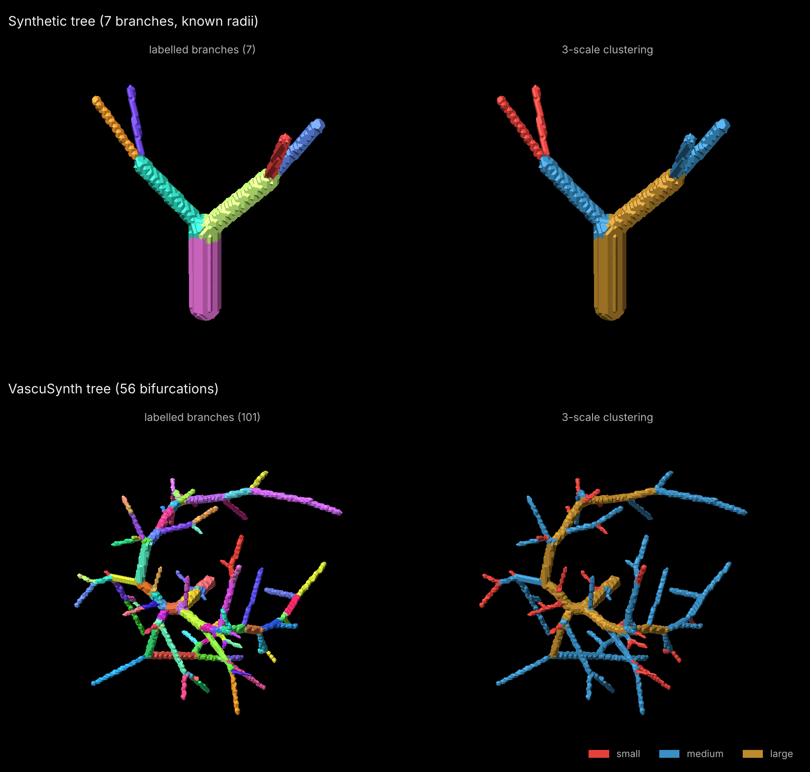
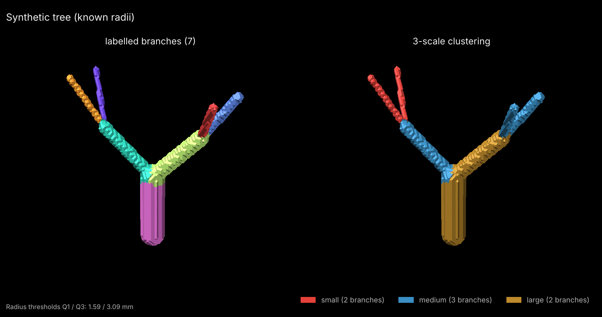
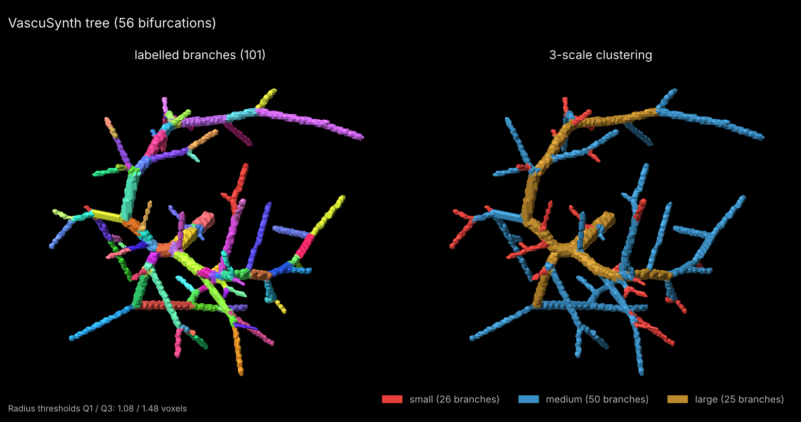

# Multi-scale vessel clustering

Decompose a binary vessel mask into **small, medium and large vessels** from the
estimated radius of each skeleton branch. This is the clustering step (Sect. 2.1) of

> A. Sadikine, B. Badic, J.-P. Tasu, V. Noblet, P. Ballet, D. Visvikis, P.-H. Conze.
> *Scale-Specific Auxiliary Multi-Task Contrastive Learning for Deep Liver Vessel Segmentation.*
> IEEE 20th International Symposium on Biomedical Imaging (ISBI), 2023.
> [doi:10.1109/ISBI53787.2023.10230364](https://doi.org/10.1109/ISBI53787.2023.10230364) ·
> [arXiv:2409.12333](https://arxiv.org/abs/2409.12333)

In the paper, the scale-specific masks are the targets of the auxiliary decoders
of a multi-task 3D U-Net. The segmentation and training code is not part of this
repository yet.



## Installation

```bash
git clone https://github.com/asadikine/vessel-scale-clustering.git
cd vessel-scale-clustering
pip install -e ".[nifti,figure]"
```

Dependencies: NumPy, SciPy, scikit-image, [skan](https://skeleton-analysis.org);
nibabel for NIfTI files and matplotlib for figures (optional extras).

## Quick start

```bash
vessel-scales examples/data/vascusynth_tree.nii.gz -o results/ --figure
```

## Command line

```bash
vessel-scales MASK [MASK ...] -o OUTPUT_FOLDER [options]
```

| Option | Default | Meaning |
|---|---|---|
| `-o`, `--output` | `vessel_scales_output` | Output folder, created if it does not exist |
| `--labels L [L ...]` | every value > 0 | Label values counted as vessel (`--labels 1` for MSD Task08, where 2 is tumour) |
| `--spacing S [S ...]` | NIfTI header (1 for `.npy`) | Voxel size, one value or one per axis |
| `--surface {mesh,voxels}` | `mesh` | Edge surface Ω used for the local radius (see [Method](#method)) |
| `--mesh-sigma S` | 0.5 | Smoothing (voxels) before meshing the surface |
| `--neighbors M` | 8 | m nearest surface points for the local radius (Eq. 1) |
| `--quantiles QL QH` | 0.25 0.75 | Per-volume radius quantiles used as thresholds |
| `--thresholds T1 T2` | — | Fixed radius thresholds instead of quantiles (not used in the paper) |
| `--figure` | off | Save a 3D render of the branches and of the scales (surface of the binary mask, not smoothed) |
| `--view ELEV AZIM` | 20 −60 | Camera angles of the 3D render, in degrees |

Several masks can be given at once (`vessel-scales masks/*.nii.gz -o results/`).
For each input `<name>`, the output folder receives:

| File | Content |
|---|---|
| `<name>_scales.nii.gz` | Scale map: 0 background, 1 small, 2 medium, 3 large |
| `<name>_small.nii.gz`, `<name>_medium.nii.gz`, `<name>_large.nii.gz` | Binary mask of each scale |
| `<name>_branch_labels.nii.gz` | One label per skeleton branch (1 … n) |
| `<name>_itksnap_labels.txt` | ITK-SNAP colours and names for the scale map |
| `<name>_branches.csv` | One row per branch: id, radius, scale, number of voxels |
| `<name>_summary.json` | Parameters, voxel size, thresholds, branch and voxel counts |
| `<name>_3d.png` | 3D render (with `--figure`) |

**Metadata.** NIfTI outputs keep the geometry of the input: affine, qform and
sform with their codes, voxel size, orientation and units, so they overlay the
input directly. Only the data type changes (uint8, or uint16 for branch labels),
the intent is set to *label* and the description field names the content.
Outputs use the extension of the input (`.nii`, `.nii.gz` or `.npy`).

### Viewing the result in 3D in ITK-SNAP

Open the scale map as a **segmentation** on top of the input mask, with the
label file for the colours:

```bash
itksnap -g mask.nii.gz -s results/mask_scales.nii.gz -l results/mask_itksnap_labels.txt
```

On macOS the executable is `/Applications/ITK-SNAP.app/Contents/bin/itksnap`.
In the GUI: *File → Open Main Image* (the mask), *Segmentation → Open
Segmentation* (`_scales.nii.gz`), *Segmentation → Import Label Descriptions*
(`_itksnap_labels.txt`), then *Update* in the 3D view. Open
`_branch_labels.nii.gz` as the segmentation instead to see one colour per branch.

## Python

```python
import nibabel as nib
from vessel_scales import cluster_vessel_scales

img = nib.load("vessels.nii.gz")
mask = img.get_fdata() > 0
res = cluster_vessel_scales(mask, spacing=img.header.get_zooms()[:3])

res.scale_map          # 0 background, 1 small, 2 medium, 3 large
res.scale_masks()      # {1: y^1, 2: y^2, 3: y^3} binary masks
res.branch_map         # branch label of every vessel voxel
res.branch_radii       # radius of each branch, in mm here
res.thresholds         # (Q1, Q3) of the branch radii of this volume
res.branch_table()     # one dict per branch: id, radius, scale, n_voxels
```

## Examples

### 1. Synthetic tree with known radii

A trunk, two children and four leaves, each with its own radius (6.0, 4.0, 3.0,
2.4, 2.0, 1.6 and 1.3 mm), with 1 mm isotropic voxels. Shipped as
`examples/data/synthetic_tree.nii.gz`.

```bash
python examples/synthetic/run_synthetic.py   # rebuilds the mask, the figure and the table
python examples/make_gallery.py              # rebuilds docs/overview.png (both trees)
vessel-scales examples/data/synthetic_tree.nii.gz -o results/ --figure
```

### 2. VascuSynth tree with ground truth

A tree simulated with [VascuSynth](https://github.com/sfu-mial/VascuSynth)
(101³ voxels, 56 bifurcations), shipped as `examples/data/vascusynth_tree.nii.gz`
with its tree structure, `vascusynth_tree_structure.mat`, which gives the true
radius of every segment. See [examples/vascusynth](examples/vascusynth/README.md)
to build VascuSynth, generate more trees and convert them to binary masks.

```bash
vessel-scales examples/data/vascusynth_tree.nii.gz -o results/ --figure
python examples/vascusynth/compare_ground_truth.py \
    examples/data/vascusynth_tree.nii.gz examples/data/vascusynth_tree_structure.mat
```

### 3. Real hepatic vessel mask

A liver vessel mask from the Medical Segmentation Decathlon (Task08 Hepatic
Vessel). See [examples/real](examples/real/README.md) for where to download it
and how to run it.

```bash
vessel-scales hepaticvessel_001.nii.gz --labels 1 -o results/ --figure
```

## Results

### Synthetic tree



| True radius (mm) | Scale from true radius | Mesh estimate (mm) | Scale | Voxel estimate (mm) | Scale |
|---|---|---|---|---|---|
| 6.0 | large | 5.66 | large | 5.10 | large |
| 4.0 | large | 3.53 | large | 3.24 | large |
| 3.0 | medium | 2.65 | medium | 2.45 | medium |
| 2.4 | medium | 2.05 | medium | 2.00 | medium |
| 2.0 | medium | 1.74 | medium | 1.41 | **small** |
| 1.6 | small | 1.43 | small | 1.41 | small |
| 1.3 | small | 1.11 | small | 1.41 | small |

"Scale from true radius" applies the same per-volume quartiles to the true
radii. With the mesh surface every branch gets that scale (100% of the voxels);
with surface voxels the 2.0, 1.6 and 1.3 mm leaves all measure √2 = 1.41 mm,
and the 2.0 mm leaf drops to *small* (95.9% of the voxels).

### VascuSynth tree



For each estimated branch, the true radius
is the median radius of the VascuSynth segments closest to its skeleton.

| Surface Ω | Distinct radii | Correlation with true radius | Median error (voxels) | Small / medium / large | Same scale as with true radii |
|---|---|---|---|---|---|
| `mesh` (default) | 98 | 0.94 | +0.33 | 26 / 50 / 25 | 80% of branches |
| `voxels` | 10 | 0.12 | +0.59 | 73 / 3 / 25 | 21% of branches |

With the true radii the 101 branches split 26 / 50 / 25. Most vessels here are
0.4 to 2.6 voxels in radius. With surface voxels, distances can only take a few
values (1, √2, √3, 2 …): 73 branches measure exactly √2, which is also Q1, so
the voxel estimate barely follows the true radius and the scales collapse into
*small*. The mesh surface gives continuous radii that follow the truth. The
positive error comes from the binarisation (every voxel touched by a vessel
counts as vessel), which thickens thin vessels.

## Method

| Step | Paper | Implementation |
|---|---|---|
| Skeleton Γ | Sect. 2.1, thinning [Lee et al., 1994] | `skimage.morphology.skeletonize(method="lee")` |
| Surface Ω | Sect. 2.1, edge surface detection | `mesh` (default): vertices of the marching-cubes surface (level 0.5) of the mask smoothed by a Gaussian of 0.5 voxel, with every mask voxel kept inside the surface so that no thin vessel is smoothed away. `voxels`: centres of the mask voxels with a face-neighbour outside the mask |
| Local radius σ̂ₖ | Eq. 1, m = 8 | Largest distance from γₖ to its `n_neighbors` (default 8) nearest surface points (k-d tree, in physical units) |
| Skeleton branches | unsupervised branch clustering | `skan.csr.Skeleton(...).path_label_image()`: the skeleton graph is split at junction and end points, one label per path |
| Branch radius r̂ⱼ | Eq. 2 | Median of σ̂ₖ over the voxels of branch j |
| Branch reconstruction | Eq. 3 | Euclidean distance transform with indices: each mask voxel takes the label of its nearest labelled centerline voxel |
| Scales | S = 3, thresholds Q1 and Q3 per volume | small: r̂ⱼ ≤ Q1, medium: Q1 < r̂ⱼ ≤ Q3, large: r̂ⱼ > Q3 |

`quantiles=(0.25, 0.75)` and `n_neighbors=8` are the paper's settings.

### Implementation choices not specified in the paper

- **Surface Ω.** The paper does not say whether Ω is made of voxels or of
  sub-voxel points. The default here is the sub-voxel mesh because it follows
  the true radius much better on thin vessels (see the results);
  `--surface voxels` gives the voxel version.
- **Ties at a threshold.** A branch whose radius equals Q1 is *small*; one equal
  to Q3 is *medium*. Ties are frequent with `--surface voxels`.
- **Junction voxels.** skan assigns each junction voxel to one of the paths
  meeting there (the last one written by `path_label_image`).
- **Isolated skeleton pieces** that skan does not turn into a path (for example
  a single voxel) get a branch label of their own.
- **No skeleton pruning.** Short spurious branches created by noisy mask surfaces
  are kept, as in the paper.

### Notes

- Radii and thresholds are in the unit of the voxel size (mm for NIfTI files).
  With anisotropic voxels, distances are computed in physical units; the mesh
  smoothing is in voxels.
- Per-volume quartiles always put about a quarter of the branches in *small* and
  a quarter in *large*, whatever the absolute radii. Use `--thresholds` to apply
  the same radii to every volume.

## Tests

```bash
pip install -e ".[test]"
pytest
```

The tests check the clustering on the synthetic tree (partition of the mask,
branches, sub-voxel radius accuracy, agreement with the scales of the true
radii, for both surfaces), the command line on a NIfTI file with an oblique
affine, anisotropic voxels and a tumour label (geometry and header preserved,
label selection, every output), and the VascuSynth converter.

## Citation

If you use this code, please cite:

```bibtex
@inproceedings{sadikine2023scale,
  author    = {Sadikine, A. and Badic, B. and Tasu, J.-P. and Noblet, V. and Ballet, P. and Visvikis, D. and Conze, P.-H.},
  title     = {Scale-Specific Auxiliary Multi-Task Contrastive Learning for Deep Liver Vessel Segmentation},
  booktitle = {2023 IEEE 20th International Symposium on Biomedical Imaging (ISBI)},
  year      = {2023},
  pages     = {1--5},
  doi       = {10.1109/ISBI53787.2023.10230364}
}
```

## Acknowledgements

This work was partially funded by LaBeX CAMI (grant ANR-11-LABX-0004) and
France Life Imaging (grant ANR-11-INBS-0006).

<p align="left">
  
  &nbsp;&nbsp;
  
  &nbsp;&nbsp;
  
</p>

## License

Code: Apache License 2.0, see [LICENSE](LICENSE) and [NOTICE](NOTICE).

Example data: `synthetic_tree.nii.gz` is generated by
`examples/synthetic/run_synthetic.py` and distributed with the code.
`vascusynth_tree.nii.gz` and `vascusynth_tree_structure.mat` were produced with
VascuSynth; please cite G. Hamarneh and P. Jassi, *VascuSynth: Simulating
vascular trees for generating volumetric image data with ground truth
segmentation and tree analysis*, Computerized Medical Imaging and Graphics
34(8), 605–616, 2010.
